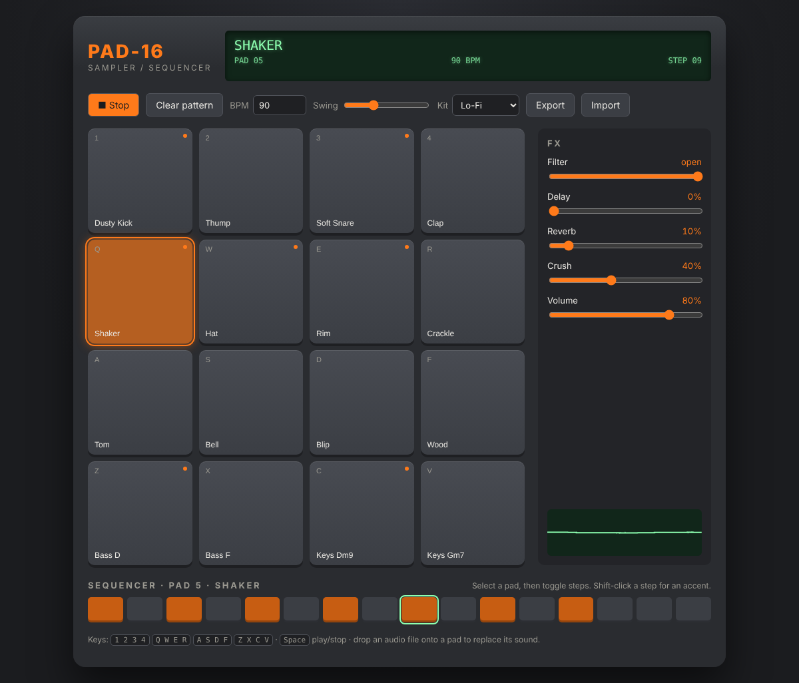
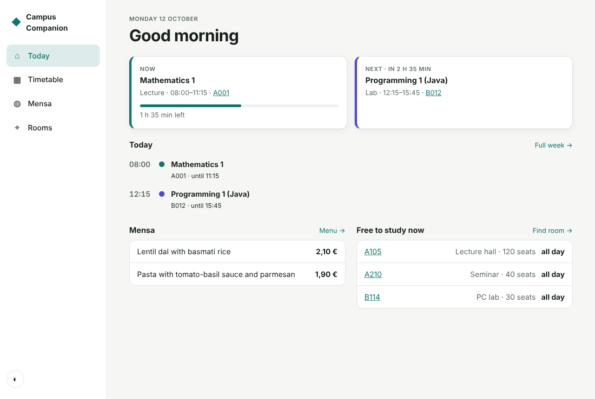

# Portfolio · Markos Kontogiorgos

Media Informatics student at Berliner Hochschule für Technik (BHT). I'm interested in the space where software meets sound, interfaces and infrastructure. This repository collects five projects from those areas. Each one has its own README, tests and, where possible, a live demo.

| Project | What it is | Stack | Demo |
|---|---|---|---|
| [**Provenance Inspector**](provenance-inspector/) | Checks files and images for disguised malware (fake invoices, macro documents, phishing PDFs), manipulation and AI origin. Verifies C2PA content credentials via WebAssembly, image forensics (ELA), privacy-first in the browser | TypeScript, WebAssembly, Web Workers, C2PA | [Open](https://g131908.github.io/portfolio/provenance-inspector/demo/) |
| [**Transit Agent · Berlin**](transit-agent/) | AI agent with tool calling and MCP server on live Berlin transit data (VBB) and weather. Resilience patterns (circuit breaker, retries, caching), Clean Architecture with enforced dependency rule | TypeScript, MCP, LLM tool calling, zod, Vitest | [Open](https://g131908.github.io/portfolio/transit-agent/demo/) |
| [**PAD-16 Sampler**](pad-sampler/) | 16-pad sampler and step sequencer in the browser, with synthesized drum kits, effects and drag-and-drop samples | JavaScript, Web Audio API, Canvas | [Open](https://g131908.github.io/portfolio/pad-sampler/) |
| [**Campus Companion**](campus-app/) | Mobile-first campus app: today view, timetable with clash detection and iCal export, Mensa menu, free-room finder | HTML, CSS, JavaScript, PWA | [Open](https://g131908.github.io/portfolio/campus-app/?now=2026-10-12T09:40) |
| [**itkit**](it-admin-toolkit/) | Command-line toolkit for IT admins: network scan, inventory, AD/Linux onboarding, SSH brute-force detection, certificate monitoring | Python (stdlib only), pytest | CLI |

<p>
  <a href="pad-sampler/"></a>
  <a href="campus-app/"></a>
</p>

## What these projects show

- **Security and media authenticity:** file-type spoofing, Office/PDF malware indicators, C2PA content credentials, image forensics (Provenance Inspector).
- **AI agents and integration:** LLM tool calling, Model Context Protocol, external APIs with timeouts, retries, circuit breakers and validated contracts (Transit Agent).
- **Audio and real-time programming:** sound synthesis, sample-accurate scheduling, an effects signal chain (PAD-16).
- **UI/UX and front-end:** responsive layouts, accessibility, dark mode, offline-capable PWA, no framework required (Campus Companion).
- **IT administration and automation:** networking, Active Directory/Linux user provisioning, log analysis, monitoring-friendly exit codes (itkit).
- **Engineering practice:** unit tests for the core logic of every project, readable commit history and documentation.

## Run everything locally

```bash
# web projects (no build step)
cd pad-sampler && npm start        # http://localhost:5173
cd campus-app  && npm start        # http://localhost:5174

# Python toolkit
cd it-admin-toolkit && pip install -e ".[dev]" && pytest
itkit --help
```

## Contact

Markos Kontogiorgos · Berlin · German, English, Greek, French
