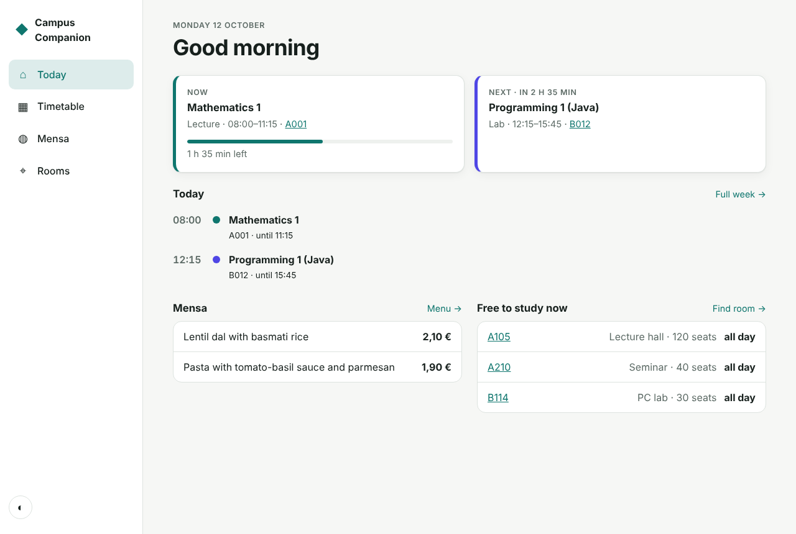

# Portfolio · Markos Kontogiorgos

Media Informatics student at Berliner Hochschule für Technik (BHT). I'm interested in the space where software meets sound, interfaces and infrastructure. This repository collects three projects from those areas. Each one has its own README, tests and, where possible, a live demo.

| Project | What it is | Stack | Demo |
|---|---|---|---|
| [**PAD-16 Sampler**](pad-sampler/) | 16-pad sampler and step sequencer in the browser, with synthesized drum kits, effects and drag-and-drop samples | JavaScript, Web Audio API, Canvas | [Open](https://g131908.github.io/portfolio/pad-sampler/) |
| [**Campus Companion**](campus-app/) | Mobile-first campus app: today view, timetable with clash detection and iCal export, Mensa menu, free-room finder | HTML, CSS, JavaScript, PWA | [Open](https://g131908.github.io/portfolio/campus-app/?now=2026-10-12T09:40) |
| [**itkit**](it-admin-toolkit/) | Command-line toolkit for IT admins: network scan, inventory, AD/Linux onboarding, SSH brute-force detection, certificate monitoring | Python (stdlib only), pytest, GitHub Actions | CLI |

<p>
  <a href="pad-sampler/"></a>
  <a href="campus-app/"></a>
</p>

## What these projects show

- **Audio and real-time programming:** sound synthesis, sample-accurate scheduling, an effects signal chain (PAD-16).
- **UI/UX and front-end:** responsive layouts, accessibility, dark mode, offline-capable PWA, no framework required (Campus Companion).
- **IT administration and automation:** networking, Active Directory/Linux user provisioning, log analysis, monitoring-friendly exit codes (itkit).
- **Engineering practice:** unit tests for the core logic of every project, CI on Linux and Windows, readable commit history and documentation.

## Run everything locally

```bash
# web projects (no build step)
cd pad-sampler && npm start        # http://localhost:5173
cd campus-app  && npm start        # http://localhost:5174

# Python toolkit
cd it-admin-toolkit && pip install -e ".[dev]" && pytest
itkit --help
```

## Contact

Markos Kontogiorgos · Berlin · German, English, Greek, French
