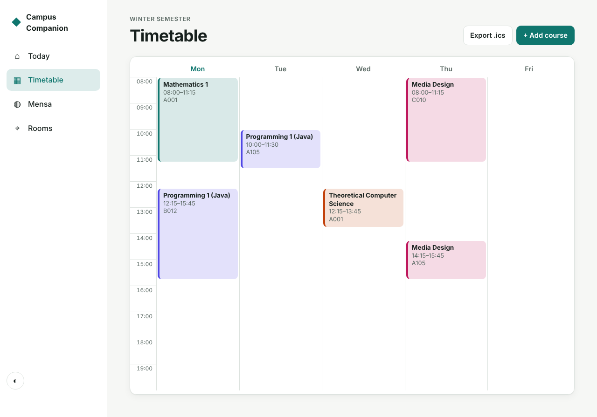
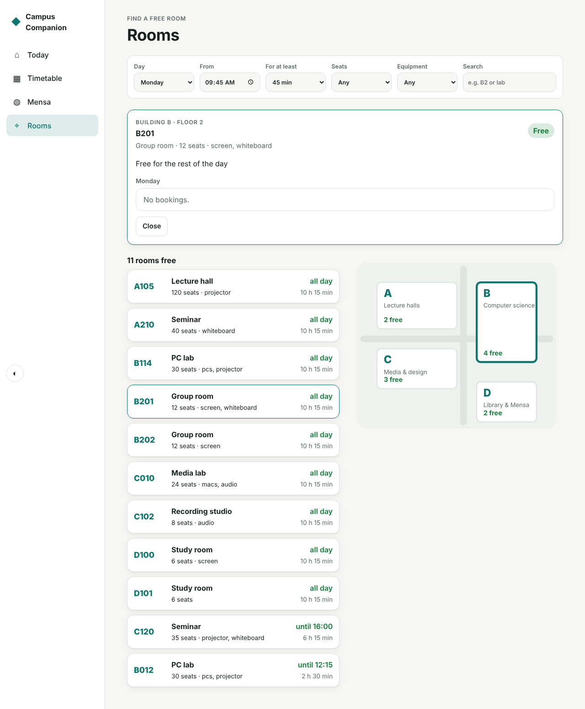
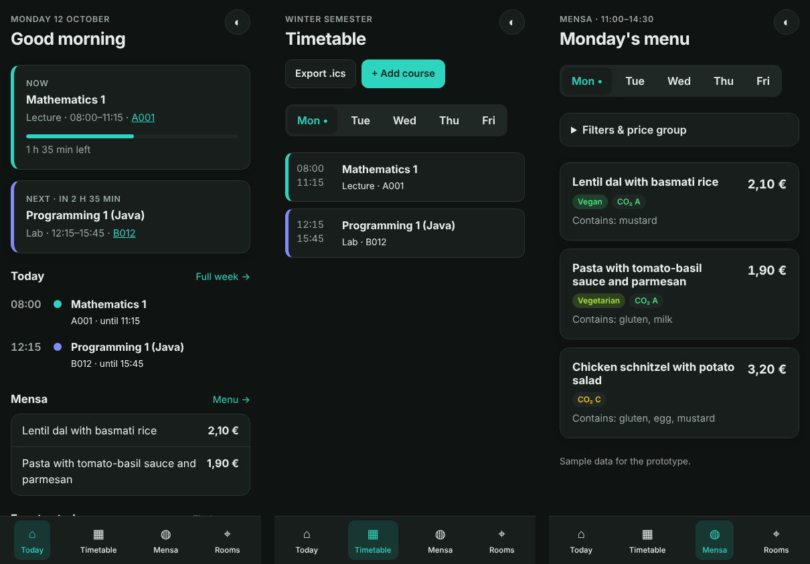

# Campus Companion

A mobile-first web app for students: what's on today, the weekly timetable, the Mensa menu and a finder for free rooms on campus. Built as a UI/UX prototype in plain HTML, CSS and JavaScript, without a framework or build step.

**[▶ Live demo](https://g131908.github.io/portfolio/campus-app/?now=2026-10-12T09:40)** (the `?now=` parameter pins the clock to a Monday morning so the demo always shows a busy day)


## Features

**Today**
- Current course with a progress bar and the time left, plus the next course (it also looks ahead to the next teaching day).
- Today's timeline, two Mensa highlights and free study rooms right now.

**Timetable**
- Week grid on desktop and a day list with tabs on mobile.
- Add, edit and delete courses in an accessible `<dialog>` form with validation.
- **Clash detection:** overlapping courses are flagged and laid out side by side.
- **Export to `.ics`** with weekly recurring events until the end of the semester. Works with Google Calendar, Outlook and Apple Calendar.

**Mensa**
- Daily menu with vegetarian/vegan filters, allergen exclusion and prices for students, staff or guests.
- CO₂ rating per dish.

**Rooms**
- Free rooms for a chosen day and time, filtered by minimum free duration, seats and equipment (PCs, projector, audio…).
- Sorted by how long a room stays free. Each room has a detail card with its day schedule.
- SVG campus map that shows the number of free rooms per building and highlights the selected one.

**General**
- Light and dark theme (follows the system setting, with a manual toggle).
- Installable PWA with offline support via a service worker.
- Your courses and preferences are kept in `localStorage`. If storage is blocked, the app falls back to memory.

| Timetable | Rooms |
|---|---|
|  |  |



## UX decisions

- **The "Today" screen answers one question first:** *where do I have to be next?* Everything else comes second.
- **Bottom navigation on phones and a sidebar on desktop.** The four destinations stay within thumb reach on mobile.
- **The week grid is replaced by a day list on small screens.** Five columns at 390 px would be unreadable.
- **Filters are collapsed by default** and open automatically once one is active, so people can see why dishes are hidden.
- **Accessibility:** semantic landmarks, a skip link, `aria-current` in the navigation, visible focus states, labelled form controls, `role="alert"` for errors, `prefers-reduced-motion`, and colours that meet WCAG AA contrast in both themes.
- **All user input is escaped** before it is rendered (try naming a course `<b>Test</b>`).

## Architecture

```
index.html
src/
  app.js            hash router + shared context (courses, prefs, clock)
  schedule.js       pure logic: time maths, conflicts, lanes, free rooms, meal filters, iCal export
  store.js          guarded localStorage + JSON data loading
  ui.js             escaping, toast, download helpers
  views/            home, timetable, mensa, rooms - each exports render(main, ctx)
  styles.css        design tokens, light/dark themes, responsive layout
data/               sample rooms, bookings, menu and courses (JSON)
sw.js               offline cache
test/               unit tests for schedule.js (Node's built-in test runner)
```

All business logic lives in `schedule.js` and has no DOM access, so it can be unit-tested and reused, for example with a real room-booking API in place of the JSON files.

## Run locally

```bash
npm start    # http://localhost:5174
npm test
```

The room, menu and course data are sample data for the prototype.

## License

MIT
