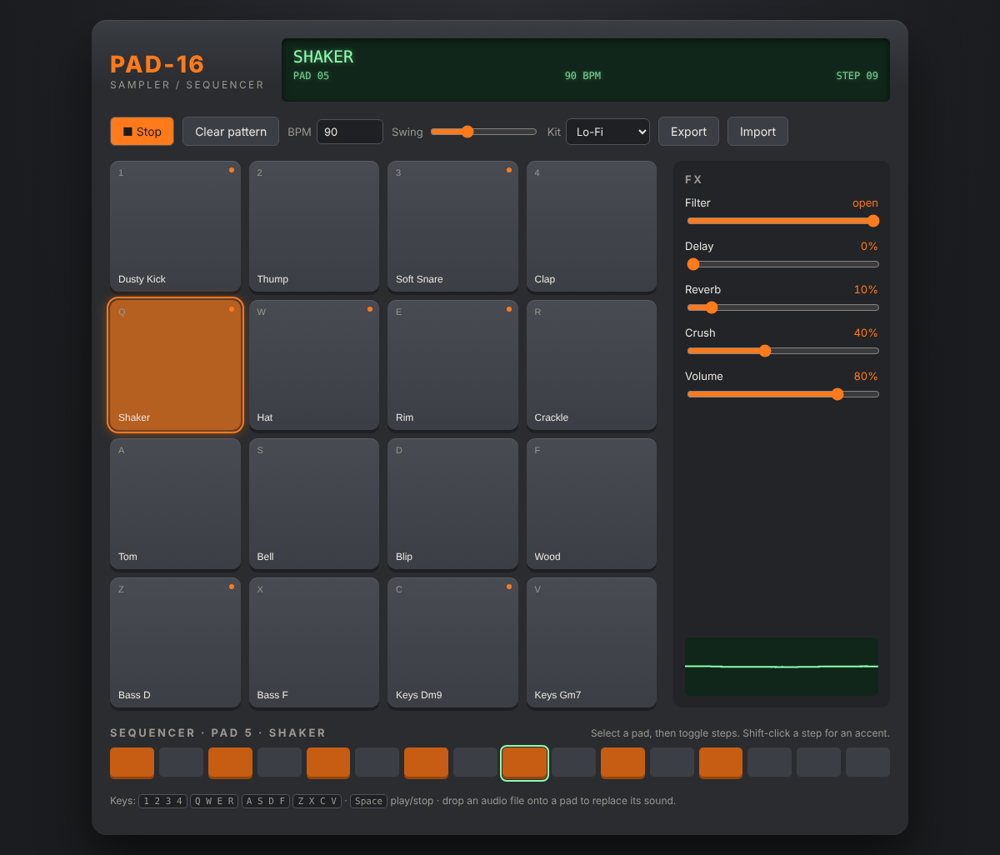

# PAD-16 · Browser Sampler

A 16-pad sampler and step sequencer that runs entirely in the browser. Inspired by hardware samplers like the SP-404 and MPC: hit pads with the keyboard, program a beat, push it through lo-fi effects, or drop your own samples onto a pad.

**[▶ Live demo](https://g131908.github.io/portfolio/pad-sampler/)**



## Features

- **16 synthesized sounds per kit.** Kicks, snares, 808-style hats, toms, FM percussion, bass and chords are generated with oscillators and noise. No sample files are needed.
- **Two kits:** Boom Bap and Lo-Fi (with tape-wobble chords and vinyl crackle).
- **16-step sequencer** with accents, swing and adjustable tempo.
- **Effects chain:** low-pass filter, tempo-synced delay, convolution reverb and a bit crusher.
- **Your own samples:** drag a WAV/MP3 onto any pad to replace its sound.
- **Hi-hat choke:** the closed hat cuts off the open hat, like on real drum machines.
- **Export and import** patterns as JSON. The last pattern is restored automatically.
- **Live oscilloscope** of the master output.
- Keyboard play (`1-4 / Q-R / A-F / Z-V`), space for play/stop, and touch support.

## How it works

```
pads / sequencer ─► bus ─► bit crusher ─► low-pass ─┬─► dry ──────────────┐
                                                    ├─► delay ⟲ feedback ─┤
                                                    └─► reverb ───────────┴─► master ─► analyser ─► speakers
```

**Sound synthesis.** Each pad recipe (`src/audio/synth.js`) is rendered once into an `AudioBuffer` with an `OfflineAudioContext`. Because of that, synthesized sounds and user samples go through exactly the same playback path, and triggering a pad only costs one `AudioBufferSourceNode`.

**Timing.** `setTimeout` alone is too imprecise for music. The sequencer (`src/sequencer.js`) uses the look-ahead pattern: a timer wakes up every 25 ms and schedules every step that falls into the next 100 ms on the sample-accurate audio clock. Swing delays every odd 16th by up to a third of a step.

**Bit crusher.** A `WaveShaperNode` with a stair-step curve reduces the effective bit depth from 16 to about 3 bits.

## Project structure

```
index.html
src/
  main.js            UI, keyboard, persistence, wiring
  sequencer.js       look-ahead scheduler, pattern model, (de)serialization
  demo-pattern.js    default groove
  audio/engine.js    audio graph, playback, effects
  audio/synth.js     drum and tone synthesis, kit definitions
  styles.css
test/
  sequencer.test.js  timing, swing, pattern round-trip
```

## Run locally

No build step and no dependencies. You only need a static file server, because ES modules don't load from `file://`:

```bash
npm start          # serves on http://localhost:5173
npm test           # runs the unit tests with Node's built-in test runner
```

## Tech

Vanilla JavaScript (ES modules), Web Audio API, Canvas 2D, CSS Grid. Works in all current desktop and mobile browsers that support the Web Audio API.

## License

MIT
