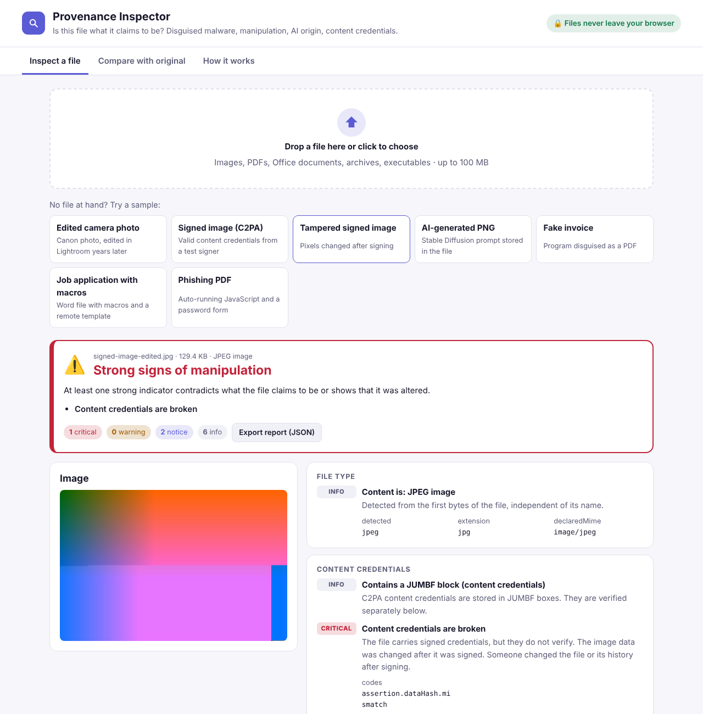
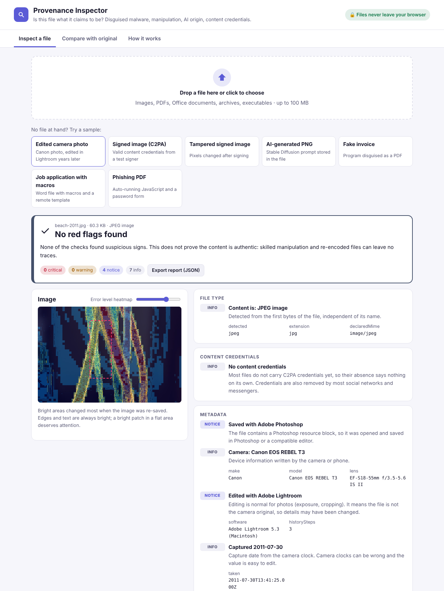
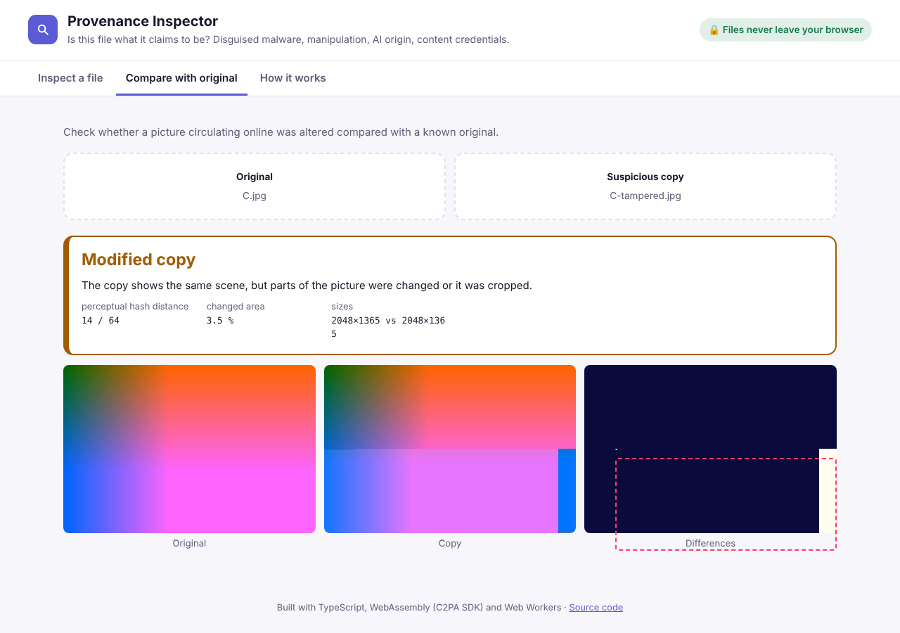

# Provenance Inspector

**Is this file what it claims to be?** A browser tool that checks files and images for disguised malware, manipulation, AI origin and signed content credentials (C2PA), and explains every finding.

**[▶ Live demo](https://g131908.github.io/portfolio/provenance-inspector/demo/)** · comes with sample files to try · files never leave your browser



## Why

Phishing attachments disguise programs as invoices. Images in the news are retouched, taken out of context or fully generated by AI. The industry's answer is **C2PA content credentials**: cryptographically signed provenance data, embedded by cameras (Leica, Sony, Nikon), editing tools (Adobe) and AI generators (OpenAI, Google, Microsoft). This project combines that standard with classic file security checks and image forensics in one transparent report.

It does **not** claim to detect "truth". It collects evidence, weighs it with an explicit policy, and says what it could not check.

## What it checks

| Area | Checks |
|---|---|
| **Disguised files** | Real type from the content ("magic bytes", 25+ formats) vs. extension and declared MIME type; double extensions (`Rechnung.pdf.exe`); right-to-left override tricks; extensions hidden behind spaces |
| **Active content** | Word/Excel/PowerPoint: VBA macros, remote template injection, DDE fields, embedded OLE objects. PDF: JavaScript (also hex-obfuscated `/J#61vaScript`), auto-run actions, `/Launch`, hidden attachments, data-sending forms. SVG/HTML with scripts. RTF exploits |
| **Container tricks** | Files appended after the end of an image (JPEG+ZIP polyglots), truncated files |
| **Content credentials (C2PA)** | Verified with the official C2PA SDK (Rust compiled to WebAssembly). Checks the signer against the official C2PA trust list, detects pixels changed after signing and altered credentials, and shows the recorded edit history and declared AI generation |
| **Metadata** | Camera, lens and capture time; editing software and XMP history; GPS; impossible dates; AI generator markers (IPTC `trainedAlgorithmicMedia`, generator names, Stable Diffusion prompts in PNG text chunks) |
| **Image forensics** | Error Level Analysis heatmap with automatic hotspot detection; JPEG quantization tables (quality estimate, standard vs. camera tables); embedded camera thumbnail compared with the visible image |
| **Compare with original** | SHA-256, perceptual hash (dHash) and a difference map with the changed region |
| **Fingerprint** | SHA-256 for lookups (e.g. VirusTotal) and later verification |

| Error Level Analysis | Compare with original |
|---|---|
|  |  |

## How the verdict is made

Each analyzer produces **findings** with a category, a severity (`info`, `notice`, `warning`, `critical`) and a polarity (supports or weakens trust), plus the raw values behind them. A single, tested policy (`src/core/assessment.ts`) turns them into one of six verdicts:

| Verdict | When |
|---|---|
| Do not open this file | Disguised executables or code that runs on open |
| Declared as AI-generated | The file's own metadata or credentials say so |
| Strong signs of manipulation | A critical indicator, e.g. broken content credentials |
| Some indicators need a closer look | Warnings such as an online PDF editor or ELA hotspots |
| Origin verified by content credentials | Valid, trusted C2PA signature and nothing contradicting it |
| No red flags found | Explicitly not presented as proof of authenticity |

Editing alone (Lightroom, Photoshop) is reported as a notice, not as an accusation. Every finding has an explanation of innocent causes where they exist.

## Architecture

```
src/
  core/          use case (InspectFile), Finding model, assessment policy. No dependencies.
  analyzers/     one module per check, pure functions over bytes: file-type, office, pdf, container,
                 jpeg, metadata, forensics (ELA, thumbnail), provenance (C2PA interpretation), compare
  adapters/      C2PA SDK (WebAssembly) behind the ProvenanceReader port; browser image decoding
  web/           UI thread, Web Worker for CPU-heavy analysis, demo samples
```

- **Isolation (bulkheads):** every analyzer runs with its own timeout and error boundary. A malformed file that crashes one parser yields a "could not finish" finding and a stated limitation instead of a broken report. Crafted files are expected input.
- **Untrusted input:** all byte reads are bounds-checked. ZIP parts are inflated selectively with a size budget (zip-bomb guard), and images above 40 MP are refused.
- **Responsiveness:** parsing, ELA and comparisons run in a Web Worker. The C2PA SDK runs in its own worker and is loaded lazily, so the fast checks show up first and the credential verification is added when ready.
- **Ports and adapters:** the provenance analyzer depends on a `ProvenanceReader` port. In the browser it is backed by the WebAssembly SDK; in tests it replays output recorded from that SDK. Dependency rules are enforced by `test/architecture.test.ts`.

## Tests

```bash
npm test     # 42 tests, Vitest, no network
```

- Disguised executables, double extensions, RLO names, SVG scripts, renamed harmless files (no false alarm)
- Office files built in the test: macros, remote templates, DDE; PDFs with JS, obfuscated names, launch actions, impossible dates
- JPEG with an appended ZIP; quantization table quality estimation; parser robustness
- Real photos (EXIF, Lightroom/Photoshop history, embedded thumbnails) and a Stable Diffusion PNG
- ELA: a synthetic forgery (patch from a low-quality JPEG pasted off-grid) must be located; a clean image must not trigger
- C2PA: valid/untrusted, pixel tampering and signature mismatch, using output recorded from the real SDK
- Use case: crashing and hanging analyzers, size limit; assessment policy ordering

The end-to-end UI run (all samples, compare mode, ELA overlay) was done in headless Chromium.

## Run locally

```bash
npm install
npm run dev      # http://localhost:5173
npm run build    # typecheck + static build into demo/
```

## Credits

- C2PA verification: [`@contentauth/c2pa-web`](https://github.com/contentauth/c2pa-js) (MIT/Apache-2.0), trust list from [c2pa-org/conformance-public](https://github.com/c2pa-org/conformance-public)
- Sample images with content credentials from the [c2pa-rs test fixtures](https://github.com/contentauth/c2pa-rs) (MIT/Apache-2.0)
- EXIF/XMP parsing: [exifr](https://github.com/MikeKovarik/exifr); JPEG codec: [jpeg-js](https://github.com/jpeg-js/jpeg-js); ZIP: [fflate](https://github.com/101arrowz/fflate)

## License

MIT
