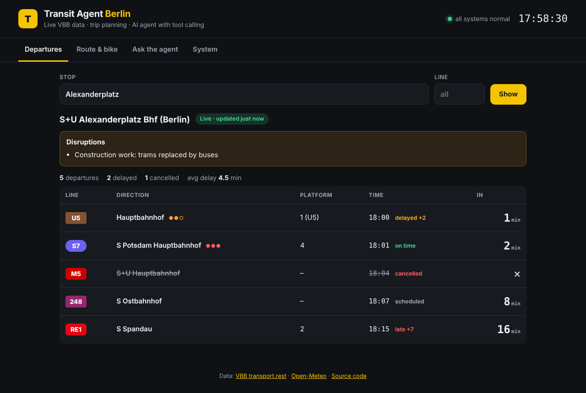
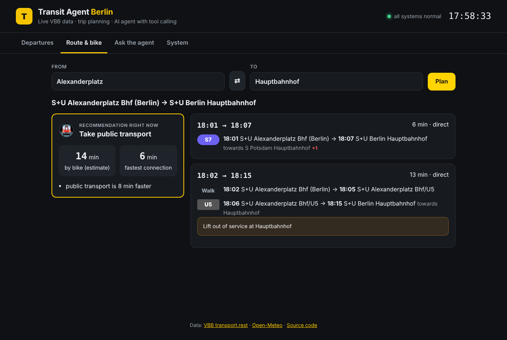
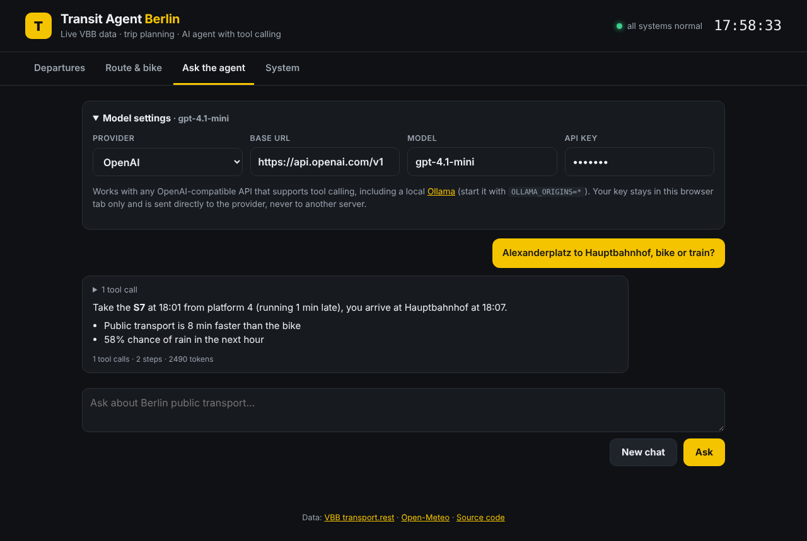

# Transit Agent · Berlin

Live Berlin public transport data, available in three ways:

1. **Web dashboard**: live departures, delays, cancellations and disruptions, plus a trip planner that tells you whether the bike or public transport is the better choice right now.
2. **AI agent with tool calling**: ask in plain language ("Leopoldplatz to Alex, bike or train?"). The model decides which tools to call and answers with live data. It works with any OpenAI-compatible model, including local models via Ollama.
3. **MCP server**: the same tools exposed over the [Model Context Protocol](https://modelcontextprotocol.io), so AI assistants and IDEs can use live VBB data.

**[▶ Live demo](https://g131908.github.io/portfolio/transit-agent/demo/)**



| Trip planner with bike advice | Agent with tool calls |
|---|---|
|  |  |

<sub>The agent screenshot comes from the end-to-end UI test, which uses recorded API data and a scripted model.</sub>

## Features

- **Live data from two public APIs:** [VBB transport.rest](https://v6.vbb.transport.rest/) (departures, journeys, stops) and [Open-Meteo](https://open-meteo.com/) (weather). No API keys are needed.
- **Departure board:** real-time delays, cancellations, platforms, expected crowding and operator disruption notices. It refreshes every 30 s, but only while the tab is visible.
- **"Bike or transit?" policy:** compares the fastest connection with an estimated cycling time (haversine distance × 1.3 detour factor at 16 km/h). Rain, rain probability, wind and frost can veto the bike. Every recommendation comes with its reasons.
- **Agent loop:** tool calling with JSON Schema generated from zod and parallel tool execution. Hard limits on steps, tool calls and tool output size keep cost and latency bounded. Conversation history is kept for follow-up questions, and the tool trace is visible in the UI.
- **MCP server:** stdio transport, four read-only tools, structured output, and domain errors reported as tool errors.
- **System view:** circuit breaker states, cache hits, retries, stale responses and p50/p95 latency per dependency.

## Architecture

```
src/
  core/                     business rules: no framework, no HTTP, no JSON
    domain/                 Departure, Journey, punctuality, bike-or-transit policy
    use-cases/              FindStops, GetDepartureBoard, PlanTrip, GetWeatherAtStop
    ports.ts                TransitGateway, WeatherGateway, Clock (owned by the core)
  infrastructure/           details, replaceable
    http/                   DependencyClient: timeout, retry, circuit breaker, cache, metrics
    vbb/                    zod contract + mapper + gateway for VBB transport.rest
    open-meteo/             weather gateway
    llm/                    OpenAI-compatible chat completions adapter
  agent/                    tool catalogue, ChatModel port, agent loop
  mcp/                      MCP server (stdio)
  web/                      dashboard (Vite, no framework)
  composition.ts            the only place that wires concrete classes
```

```
 web UI ─┐                       ┌─► VbbTransitGateway ──► DependencyClient ──► VBB API
 agent ──┼─► use cases (core) ◄──┤        (ports implemented in infrastructure)
 MCP ────┘                       └─► OpenMeteoGateway ──► DependencyClient ──► Open-Meteo
```

Dependencies point inward. The core has no imports outside itself, which `test/architecture.test.ts` checks on every test run.

## Engineering principles applied

The project follows the rule sets from [ciembor/agent-rules-books](https://github.com/ciembor/agent-rules-books), which distil classic software engineering books into checklists. The same rules are in [`AGENTS.md`](AGENTS.md) for anyone (human or coding agent) who works on this code.

| Book | Where it shows |
|---|---|
| **Clean Architecture** (Martin) | Use cases depend on ports owned by the core. Adapters translate wire formats and contain no business decisions. Wiring happens only in `composition.ts`. The dependency rule is enforced by a test, not just drawn in a diagram. |
| **Release It!** (Nygard) | Every outbound call has an explicit timeout and bounded retries with exponential backoff and full jitter (only for 5xx, 429 and network errors, with `Retry-After` respected). It also has a total time budget and a circuit breaker per dependency (404s do not trip it). Caches are bounded, and the agent loop has governors for steps, calls and output size. |
| **Designing Data-Intensive Applications** (Kleppmann) | The VBB API is the source of truth; everything cached is derived data that can lag. Every result carries `asOf` and `stale`, and the UI and the agent tell the user when they see an older copy (stale-if-error). Single-flight prevents cache stampedes. A tolerant reader means new upstream fields do not break us. |
| **A Philosophy of Software Design** (Ousterhout) | `DependencyClient` is one deep module: callers say "validated JSON from this URL" and the retry, breaker, cache and metrics stay hidden. `FindStops.resolve` lets every caller pass names or ids. |
| **Clean Code** | Small, intention-revealing functions and names from the domain (`punctuality`, `bestKnownTime`, `adviseMobility`). |

External data is never trusted. Every response is validated with zod before it reaches the cache or the domain, so a malformed response becomes an `invalid-data` failure instead of a broken UI.

## Tests

```bash
npm test
```

58 tests with Vitest, no network required:

- **Domain and use cases** with in-memory fakes (punctuality, journeys, bike policy, board summary, graceful degradation when the weather service is down)
- **Resilience:** retry and backoff, `Retry-After`, timeouts, circuit breaker open/half-open/closed, stale-if-error, single-flight, LRU bound, time budget
- **Contract tests** that map responses recorded from the real VBB and Open-Meteo APIs to the domain
- **Agent loop** with a scripted model: tool round trips, parallel calls, malformed tool arguments, step limit, history
- **MCP server** via the SDK's in-memory transport: tool listing, schemas, structured results, error handling
- **Architecture:** forbidden imports between layers fail the build

## Run it

Requires Node 20+.

```bash
npm install
npm run dev          # dashboard on http://localhost:5173
npm test
npm run build        # typecheck + static site (demo/) + bundled MCP server (dist/)
```

### Use the MCP server

```bash
npm run build:mcp    # creates dist/mcp-server.js
```

Add it to any MCP client configuration (Cursor, VS Code, desktop assistants):

```json
{
  "mcpServers": {
    "berlin-transit": {
      "command": "node",
      "args": ["/absolute/path/to/transit-agent/dist/mcp-server.js"]
    }
  }
}
```

Tools: `find_stops`, `departure_board`, `plan_trip`, `weather_at_stop`.

### Use the agent with a local model

```bash
OLLAMA_ORIGINS=* ollama serve
ollama pull qwen2.5:7b
```

Then pick "Ollama (local)" in the agent settings. With hosted providers (OpenAI, Groq, OpenRouter) the API key is kept only in the browser tab's session storage and is sent directly to the provider.

## Tech

TypeScript (strict), zod 4, Model Context Protocol SDK, Vite, Vitest, esbuild. The web UI has no framework.

## License

Copyright © 2026 Markos Kontogiorgos. All rights reserved. The code is public for viewing and evaluation only; see [LICENSE](../LICENSE).
